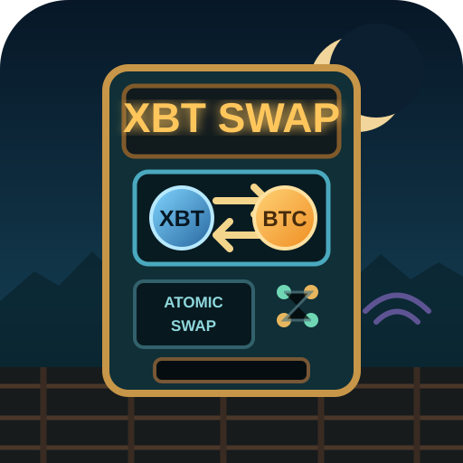

<p align="center">
  
</p>

# BLAKE Swap on StartOS

BLAKE Swap is an operator-driven StartOS package for coordinating and executing
BLAKE/BTC atomic swaps using external chain providers and configurable Nostr
relays.

The package uses the existing BLAKE Swap engine and CLI. It persists swap state
and its Nostr participant identity in the package volume, uses a StartOS Bitcoin
Knots service as the BLAKE-chain provider, and connects to an explicitly
configured ordinary Bitcoin Core RPC provider for BTC.

Initial BLAKE HTLC funding remains an explicit operator action. Post-funding
settlement and recovery can be resumed through guarded actions. Nostr is used
for coordination only; chain state remains authoritative for settlement and
recovery.

This remains an alpha package for private development and testing. The package
has been built, sideloaded, and exercised on StartOS hardware, but publication
is blocked until licensing and package metadata are resolved.

<!--
TODO: fill in the sections below, then delete these comments.

Read Writing Service READMEs first — it is the authority on who reads this file,
why the heading set is fixed and ordered, and what belongs in each section:

  ../src/writing-readmes.md
  https://docs.start9.com/packaging/writing-readmes.html
-->

## Table of Contents

<!-- TODO: link every section present below -->

## Image and Container Runtime

<!-- TODO: image source, architectures, entrypoint, and the subcontainers this package runs -->

## Volume and Data Layout

<!-- TODO -->

## File Models

<!-- TODO: each config file the package owns — format, how it's seeded, what rewrites it, and whether a hand edit survives -->

## Dependencies

<!-- TODO: list each dependency, or "None." -->

## Network Access and Interfaces

<!-- TODO -->

## Installation and First-Run Flow

<!-- TODO: what setup differs from upstream, and any ordering the user must respect -->

## Actions

<!-- TODO: each user-facing action — when to run it, what it changes, cost, repeat safety. Or "None." -->

## Tasks

<!-- TODO: each task — what raises it, severity, what clears it. Or "None." -->

## Health Checks

<!-- TODO: what each check probes, and what a failure means -->

## Backups and Restore

<!-- TODO -->

## Limitations and Differences

### Wallet ownership and ordinary withdrawals

BLAKE Swap does not create or custody separate application wallets. It uses
explicitly configured wallets owned by the chain node services.

The BLAKE-side wallet is managed by the Bitcoin Knots service. The BTC-side
wallet is managed by the configured Bitcoin Core node. Ordinary wallet
operations such as checking balances, generating general-purpose receive
addresses, backing up wallets, restoring wallets, and sending funds to unrelated
external wallets should be performed through those node services rather than
through BLAKE Swap.

BLAKE Swap intentionally does not expose a generic withdrawal or arbitrary RPC
interface. Its wallet access is limited to operations needed for the atomic-swap
workflow and narrowly scoped operator actions.

Other current limitations include:

- Bitcoin economic actions require the configured BTC node to be fully synced
  and out of initial block download.
- Nostr relay availability and write policy are controlled by the configured
  relay operators. Some relays may impose their own access requirements.
- The package does not bundle chain nodes or a local Nostr relay.
- There is no custom web application; operation uses StartOS actions.
- No open-source license has yet been established for this package or the
  included upstream BLAKE Swap source snapshot.
- Publication metadata and public project URLs remain unresolved.

---

## Quick Reference for AI Consumers

```yaml
package_id: 'blake-swap'
image:
architectures: []
subcontainers: []
volumes: {}
file_models: []
startos_managed_env_vars: []
dependencies: []
interfaces: {}
actions: []
tasks: []
health_checks: []
```
